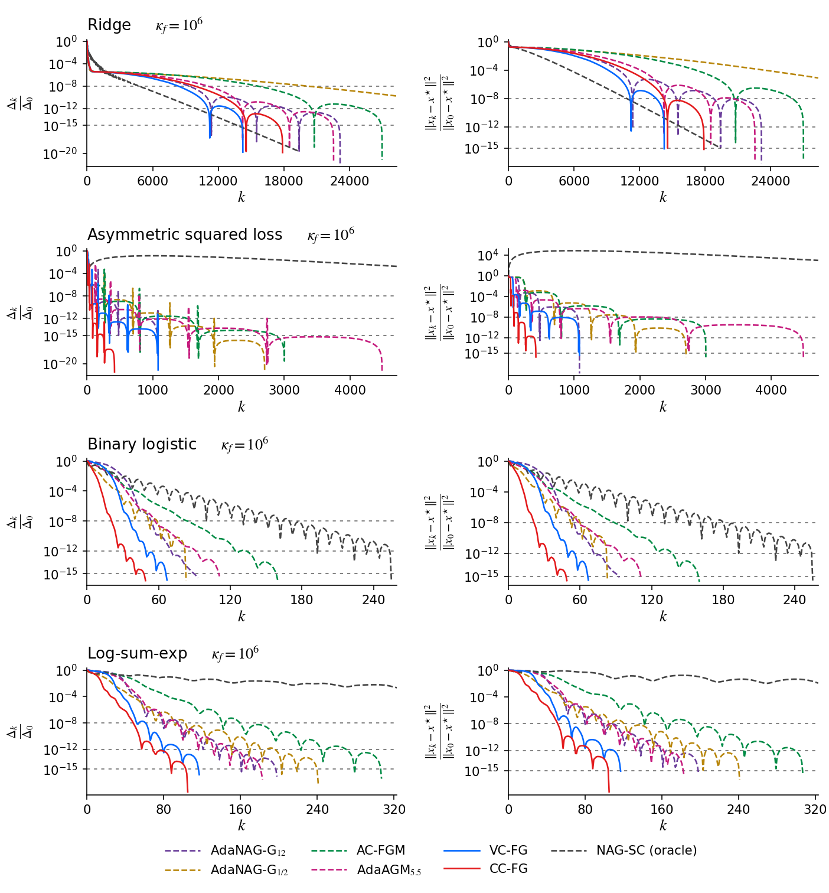

# SC Framework: Numerical Experiments

Reproducible experiments for **Linear Convergence of Adaptive Accelerated
Gradient Methods: A Unified Framework**.

This repository contains seven full-gradient methods, four synthetic strongly
convex problem families, saved experiment results, and scripts that generate the
figures and iteration-count tables. All problem data are generated locally; no
external dataset is required.

For detailed Chinese instructions, see [运行说明.txt](运行说明.txt).



## Installation

Use **Python 3.11**. The supplied dependency versions have been checked with
Python 3.11.5.

From this repository's root directory:

```bash
python -m venv .venv
```

Activate the environment on macOS or Linux:

```bash
source .venv/bin/activate
```

On Windows PowerShell:

```powershell
.venv\Scripts\Activate.ps1
```

Install the pinned dependencies:

```bash
python -m pip install -r requirements.txt
```

The dependencies are NumPy 2.2.3, SciPy 1.16.2, Matplotlib 3.10.0, and
threadpoolctl 3.6.0. A TeX installation is not needed to generate the figures or
the table source.

## Recreate figures and tables from the supplied results

```bash
python present.py
```

This reads `results/runs.csv` and `results/curves.npz`, checks that the displayed
trajectories agree with the recorded threshold crossings, and regenerates:

- One eight-panel figure: `figures/all_families_grid.pdf` and `.png`.
- Four paired figures: `figures/*_pair.pdf` and `.png`.
- Eight individual figures: `figures/single/*.pdf` and `.png`.
- `tables/winners.tex`, `tables/winners.csv`, and `tables/median_iterations.csv`.

Seven distinct colors identify the methods. VC-FG and CC-FG use solid lines;
all other methods use dashed lines. Every method has the same line width.

## Rerun all experiments

```bash
python run.py --workers 4
python present.py
```

Use `--workers 1` for serial execution. Alternatively, `python main.py` runs the
full experiment with four workers and then generates the figures and tables.
The full run overwrites `results/`; plotting overwrites `figures/` and `tables/`.

## Experimental setup

The experiment comprises **4 problem families × 5 instances × 7 condition
numbers × 7 methods = 980 runs**. Every problem has dimension 32.

| Family | Construction |
| --- | --- |
| Ridge regression | 24 samples, uniform design, quadratic regularization |
| Asymmetric squared loss | Gaussian center and coordinatewise asymmetric curvature |
| Binary logistic regression | 128 Gaussian samples, random binary labels, quadratic regularization |
| Log-sum-exp | 128 Gaussian affine functions and quadratic regularization |

The prescribed ratios `L / mu` are `2, 10, 100, 1000, 10000, 100000, 1000000`.
For log-sum-exp this ratio uses the stated global smoothness upper bound.

| Display name | Implementation key |
| --- | --- |
| AdaNAG-G12 | `adanag_g12` |
| AdaNAG-G1/2 | `adanag_g_half` |
| AC-FGM | `ac_fgm_a01` |
| AdaAGM5.5 | `adaagm55` |
| VC-FG | `fg_original` |
| CC-FG | `widecap` |
| NAG-SC (oracle) | `nag_sc_oracle` |

The implementation keys are retained in the saved data. AdaAGM5.5 denotes the
experimental specialization associated with Corollary 5.5 of the original
AdaAGM preprint; it is not a sweep over the full admissible parameter family.
Its fixed parameters are `(m, gamma, beta_AGM, theta_0) = (1/8, 1/2, 1, 2)`.
AC-FGM uses `a = 1/10` and `beta_AC = 1 - sqrt(6)/3`. All update rules and
initializations are specified in `solvers.py`. Only NAG-SC is supplied with the
global bounds `mu` and `L` for its updates.

### Randomness and iteration counts

Each instance uses
`numpy.random.SeedSequence([replicate, FAMILIES.index(family)])`, where
`replicate` ranges from 0 to 4. The internal family order is
`ridge, logistic, asymmetric, logsumexp`; preserve this order when reproducing
the supplied draws. Within an instance, sampled data and the starting point
are shared across methods and condition numbers.

An accepted update increases the iteration index by one, starting at `k = 0`.
The two monitored errors are the relative objective gap and relative squared
distance to the minimizer. The numerical monitor accounts for the residual of
the computed reference solution; see `run.py` and `problems.py` for the exact
calculation. First crossings are recorded at `1e-8`, `1e-12`, and `1e-15`.
A run stops when both errors are at most `1e-15` at the same iterate, or after
150,000 accepted updates.

The supplied results contain 980 successful runs, with a largest stopping
index of 59,688. Figures show replicate 0 at `L / mu = 1000000`. For a family
whose longest trajectory exceeds twice the second longest, both panels are
cropped at 105% of the second-longest stopping index, rounded up. Cropping
affects only the figures. The tables use complete runs and take the median of
the five first-hit iteration counts for each method before selecting winners.

Saved results are included so the supplied figures can be reproduced without
rerunning the solvers. Last digits and very tight threshold-crossing indices
can vary across numerical libraries or platforms.

## Files

```text
main.py                 Full experiment and reporting entry point
run.py                  Experiment grid, error monitor, and result recording
problems.py             Synthetic objectives, gradients, and reference solutions
solvers.py              Seven methods and their initializations
present.py              Figures and iteration-count tables
requirements.txt        Pinned Python dependencies
运行说明.txt             Detailed Chinese instructions
results/
  runs.csv              980 solver runs and first-crossing indices
  instances.csv         140 problem instances and reference diagnostics
  curves.npz            28 complete displayed trajectories: k, objective, distance
  references.npz        Reference solutions for all 140 problems
tables/                 Winner tables and complete method medians
figures/                PDF and PNG figures, including individual panels
```

Run commands from the repository root. Output paths are resolved relative to
the scripts, so they do not depend on any author's local directory layout.

## License

This project's code is licensed under the [MIT License](LICENSE).
Copyright (c) 2026 Ming Yan and Weihe Zhang.
Third-party dependencies retain their respective licenses.
