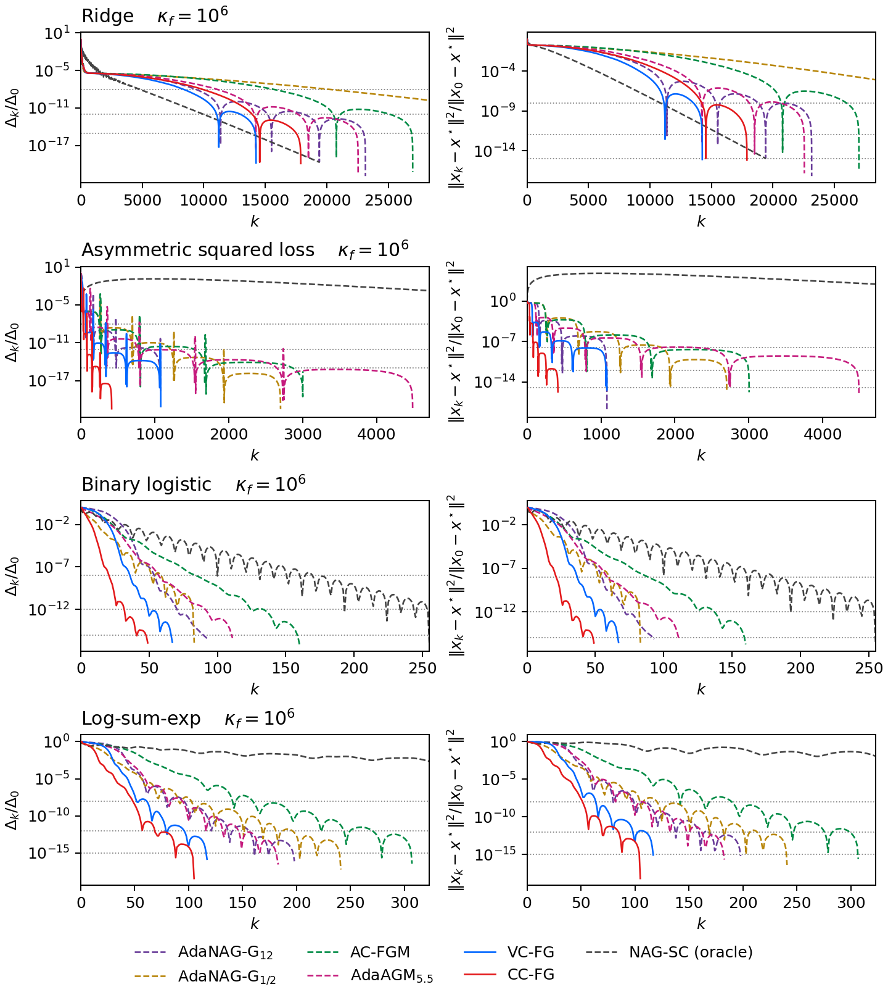
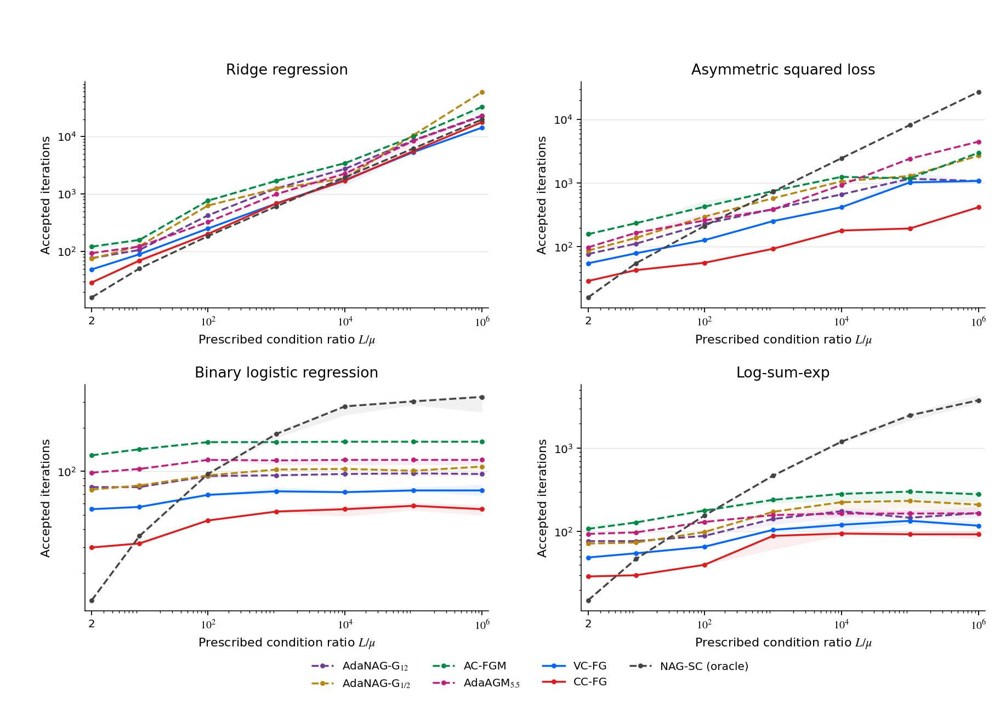

# SC Framework: Numerical Experiments

Reproducible experiments for **Linear Convergence of Adaptive Accelerated
Gradient Methods: A Unified Framework**.

This repository contains seven full-gradient methods, four synthetic strongly
convex problem families, saved experiment results, and scripts that generate the
two figures. The scripts generate the problem data locally.






## Installation

Use **Python 3.11**. The supplied dependency versions have been checked with
Python 3.11.5.

From this repository's root directory:

```bash
python -m venv .venv
```

Activate the environment on macOS or Linux:

```bash
source .venv/bin/activate
```

On Windows PowerShell:

```powershell
.venv\Scripts\Activate.ps1
```

Install the pinned dependencies:

```bash
python -m pip install -r requirements.txt
```

The dependencies are NumPy 2.2.3, SciPy 1.16.2, Matplotlib 3.10.0, and
threadpoolctl 3.6.0.

## Run the experiments

```bash
python main.py
```

The program runs in three stages.

1. `run_experiments(workers)` runs the 980 experiments and returns their records.
2. `save_results(records)` writes the run records, instance data, reference points and convergence trajectories to `results/`.
3. `make_figures()` reads the saved data and draws the two figures below. Each is saved as a PDF and a PNG.

The default is four workers. Use `python main.py --workers 1` for serial execution, or `python main.py --mode run` to compute and save the experimental results.

## Draw the two figures from saved results

```bash
python main.py --mode plot
```

- `python plot_convergence.py` reads `results/curves.npz` and produces the eight-panel convergence plot in `figures/convergence/all_families_grid.pdf` and `.png`.
- `python plot_iterations_by_kappa.py` reads `results/runs.csv` and produces the four-panel iteration count plot in `figures/iterations_by_kappa/median_iterations_1e-15.pdf` and `.png`.

Seven distinct colors identify the methods. VC-FG and CC-FG use solid lines, and the other methods use dashed lines. Every method has the same line width.

## Experimental setup

The experiment comprises **4 problem families × 5 instances × 7 condition
numbers × 7 methods = 980 runs**. Every problem has dimension 32.

- **Ridge regression** — 24 samples, uniform design, quadratic regularization
- **Asymmetric squared loss** — Gaussian center and coordinatewise asymmetric curvature
- **Binary logistic regression** — 128 Gaussian samples, random binary labels, quadratic regularization
- **Log-sum-exp** — 128 Gaussian affine functions and quadratic regularization

The prescribed ratios `L / mu` are `2, 10, 100, 1000, 10000, 100000, 1000000`.
For log-sum-exp this ratio uses the stated global smoothness upper bound.

- **AdaNAG-G12** — `adanag_g12`
- **AdaNAG-G1/2** — `adanag_g_half`
- **AC-FGM** — `ac_fgm_a01`
- **AdaAGM5.5** — `adaagm55`
- **VC-FG** — `fg_original`
- **CC-FG** — `widecap`
- **NAG-SC (oracle)** — `nag_sc_oracle`

The implementation keys are retained in the saved data. AdaAGM5.5 denotes the
experimental specialization associated with Corollary 5.5 of the original
AdaAGM preprint; it is not a sweep over the full admissible parameter family.
Its fixed parameters are `(m, gamma, beta_AGM, theta_0) = (1/8, 1/2, 1, 2)`.
The curvature rule corresponds to `omega = eta = 1/2` in the general notation.
AC-FGM uses `a = 1/10` and `beta_AC = 1 - sqrt(6)/3`. All update rules and
initializations are specified in `solvers.py`. Only NAG-SC is supplied with the
global bounds `mu` and `L` for its updates.

### Randomness and iteration counts

Each instance uses
`numpy.random.SeedSequence([replicate, FAMILIES.index(family)])`, where
`replicate` ranges from 0 to 4. The internal family order is
`ridge, logistic, asymmetric, logsumexp`; preserve this order when reproducing
the supplied draws. Within an instance, sampled data and the starting point
are shared across methods and condition numbers.

An accepted update increases the iteration index by one, starting at `k = 0`.
For each problem instance, `Problem.reference()` determines a sufficiently
accurate reference point `xref`. All seven methods use the same point. At each
iterate, the monitor measures the objective gap and squared distance relative
to their starting values, using `(f(x) - f(xref)) / (f(x0) - f(xref))` and
`(norm(x - xref) / norm(x0 - xref))**2`. First crossings are recorded at
`1e-8`, `1e-12`, and `1e-15`.
A run stops when both errors are at most `1e-15` at the same iterate, or after
150,000 accepted updates.

The supplied results contain 980 successful runs, with a largest stopping
index of 59,687. The convergence figure shows replicate 0 at `L / mu = 1000000`. For a family
whose longest trajectory exceeds twice the second longest, both panels are
cropped at 105% of the second-longest stopping index, rounded up. Cropping
changes only the displayed range.

The conditioning comparison shows the median accepted iteration count to
reach both errors at `1e-15` in the same iterate. Shaded bands span the first
and third quartiles over the five matched draws; they are not confidence
intervals. Both axes use logarithmic scales, and all counts use complete runs.

Saved results are included so the supplied figures can be reproduced without
rerunning the solvers. Last digits and very tight threshold-crossing indices
can vary across numerical libraries or platforms.

## Files

```text
problems.py             Synthetic objectives, gradients, and reference solutions
solvers.py              Seven methods and their initializations
main.py                 Experiment grid, error monitor, and saved results
plot_convergence.py          Draw the convergence curves from results/curves.npz
plot_iterations_by_kappa.py  Draw the median iteration count chart from results/runs.csv
requirements.txt        Pinned Python dependencies
results/
  runs.csv              980 solver runs and first-crossing indices
  instances.csv         Identifiers and model parameters for the 140 problem instances
  curves.npz            28 complete displayed trajectories: k, objective, distance
  references.npz        Reference solutions for all 140 problems
figures/
  convergence/          Combined four-family convergence figure
  iterations_by_kappa/  Median iteration count figure at the 1e-15 target
```

Run commands from the repository root. Output paths are resolved relative to
the scripts, so they do not depend on any author's local directory layout.

The experiment driver `main.py` calls `problems.py` and `solvers.py`.
Edit the convergence curves in `plot_convergence.py` and the conditioning figure
in `plot_iterations_by_kappa.py`. Both use the styles in `PLOT_STYLES`
in `plot_convergence.py`.
The sampling order, random seeds, starting points, objective definitions, and
algorithm initializations remain those used for the supplied paper results.

## Reading the implementation

The structural reference is the authors' [AC-FGM implementation](https://github.com/tli432/AC-FGM-Implementation/tree/50379ca112c6cb46b8b5003f9aa83f7257378dfb):
problem objects provide the objective and gradient, and distinct algorithms
have separate initialization and iteration routines. Our problem definitions
remain those in our manuscript; the reference repository uses different
test problems and regularizers.

Read the code in this order:

1. `Problem.__init__`, `set_kappa`, and `oracle` in `problems.py`: sample once,
   select the condition ratio, and evaluate the full objective and gradient.
2. `run_solver` in `solvers.py`: initialize the starting point and dispatch.
3. Open the function for the method of interest. VC-FG and CC-FG use
   `run_vc_fg` and `run_cc_fg`. The two AdaNAG methods use `run_adanag_g12`
   and `run_adanag_g_half`. AC-FGM, AdaAGM, and NAG-SC use `run_ac_fgm`,
   `run_adaagm`, and `run_nag_sc`. Each contains its stepsize and update loop.
4. `run_base` and its `monitor` in `main.py`: measure errors and record the
   first accepted iteration satisfying each tolerance.
5. In `main.py`, `save_results(records)` writes the data, and `make_figures()` calls both plotting routines.
   `plot_iterations_by_kappa.py` reads the `kjoint_15` column of `results/runs.csv`
   to compute the median and interquartile range for each point.

AC-FGM follows [Corollary 2 of Li and Lan](https://arxiv.org/html/2310.10082v3#S2):
the measured first-step secant determines the second stepsize, and the second
update uses `tau_2 = 1`. The referenced public code advances this recurrence
earlier, so its structure is a reference, not an executable specification.
AdaAGM uses its native zero-curvature convention when consecutive gradients
are equal; in that case only the growth bound limits the next stepsize.

Stable Bregman formulas avoid subtracting nearly equal function values near
the `1e-15` target. The monitor uses the Bregman divergence and the gradient
at `xref` to evaluate the objective difference.

Across the 980 experiments, no AdaAGM equal-gradient event occurred before
stopping. A separate strongly convex quadratic regression case checks
that the native zero-curvature rule can escape floating-point stagnation.

## License

This project's code is licensed under the [MIT License](LICENSE).
Copyright (c) 2026 Ming Yan and Weihe Zhang.
Third-party dependencies retain their respective licenses.
